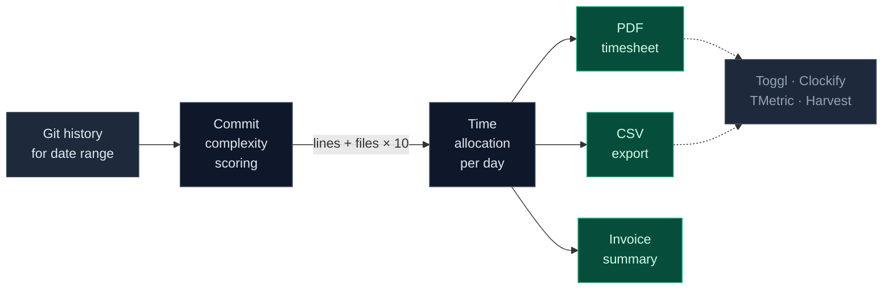

<div align="center">
  

  <h1>git-timesheet</h1>

  <p><strong>Stop filling timesheets manually. Let your commits tell the story.</strong></p>

  <p>
    A Claude Code plugin that turns your git history into realistic weekly timesheets.<br />
    Hours are allocated by commit complexity, not split evenly.
  </p>

  <p>
    
    
    
  </p>

  <p>
    <a href="#install">Install</a> ·
    <a href="#quick-start">Quick start</a> ·
    <a href="#how-it-works">How it works</a> ·
    <a href="#custom-pdf-templates">Templates</a> ·
    <a href="#time-tracker-integrations">Integrations</a>
  </p>
</div>

---

## Why

- **Realistic hours** — 8h split proportionally by commit weight, never a flat 4+4
- **Invoice totals** — set your hourly rate once, get `hours × rate` computed
- **Zero data entry** — pick a date range, the rest comes from git
- **Multi-format** — print-ready PDF, importable CSV, or both
- **Push integrations** — Toggl, Clockify, TMetric, Harvest APIs
- **Custom PDF layouts** — import your company's timesheet and match it
- **International** — 9 countries of holidays, 6 built-in languages + dynamic translation

[Sample PDF output](./examples/sample-timesheet.pdf)

---

## Install

Install via the Claude Code plugin marketplace — one command:

```
/plugin marketplace add MarcinSufa/git-timesheet
/plugin install git-timesheet@marcin-sufa-plugins
```

That's it. `/timesheet` is now available in any Claude Code session.

To update later:

```
/plugin marketplace update marcin-sufa-plugins
```

---

## Quick start

```bash
# Interactive — walks you through setup
/timesheet

# Pick a preset period
/timesheet --range first-half           # 1st-15th of current month
/timesheet --range second-half          # 16th-end of current month
/timesheet --range last-month           # 1st-end of previous month

# Custom date range
/timesheet 16 Mar to 15 Apr

# Use a saved profile
/timesheet --profile my-profile

# Import your company's timesheet format
/timesheet --import-template ~/Downloads/company-timesheet.pdf

# Generate and push to time tracker
/timesheet --range first-half --push toggl
```

On first run, the skill asks a handful of questions (git authors, repos, hours/day, country, language, output format). Save the answers as a profile and never set up again.

---

## How it works



**Allocation example** — a day with two commits:

| Commit | Lines | Files | Score | Time |
|---|---|---|---|---|
| `feat(auth): Add OAuth2 flow` | 150 | 8 | 230 | **6:45** |
| `fix(ui): Button alignment` | 3 | 1 | 13 | **1:15** |

Result: **6:45 + 1:15 = 8:00** — not 4:00 + 4:00.

Formula: `score = lines_changed + (files_changed × 10)`. Minimum floor of 20 (because every fix takes investigation + testing).

---

## Features

### Generation

- Weekly timesheets (Mon-Sun) per member, per week in range
- Time allocated proportionally by commit complexity
- Default 8h/day, configurable (8h, 7.5h, 7h, 6h, custom)
- 15-min, 30-min, or 1-hour increments
- Optional overtime cap

### Invoicing

- Post-generation invoice summary
- `hours × hourlyRate` with currency
- Saves your rate to profile for reuse
- Only `Billable: Yes` rows count toward the total

### Holidays & days off

- 9 countries of public holidays built-in:

  `US` · `GB` · `DE` · `PL` · `AU` · `NZ` · `CA` · `FR` · `NL`

- Easter-dependent holidays computed via the computus algorithm
- Mark PTO and sick days per run — hours redistribute across remaining work days

### Date presets

- `first-half`, `second-half`, `full-month`, `last-month`, `this-week`, `last-week`
- Offsets: `--range first-half:2026-03` or `--range second-half:march`
- Custom presets saved in profile (e.g., `biweekly-1`, `fiscal-q1`)

### Multi-member

- Single profile can hold a whole team
- Separate git author patterns per member
- One timesheet per member per week

### Project mapping

- Map git `scope(...)` to real project names
- `feat(auth): ...` → "My App — Auth"
- Useful when pushing to Toggl/TMetric where project names matter

---

## Custom PDF templates

Your company has a specific timesheet format? Give the plugin a sample file and it matches it:

```
/timesheet --import-template ~/Downloads/our-timesheet.pdf
```

The plugin analyzes the layout (columns, colors, fonts, logo placement, headers) and generates a matching HTML template. Supports **PDF, PNG, JPG, DOCX** inputs.

Templates are saved in `~/.claude/skills/timesheet/templates/` and reusable across runs.

Refine an existing template via natural language:

```
/timesheet --edit-template company-x
# "make the header bigger"
# "switch to A4 portrait"
# "add the logo at top-right"
```

---

## Profiles

Save your setup once, reuse forever:

```json
{
  "name": "my-profile",
  "members": [
    {
      "displayName": "Jane Doe",
      "gitAuthors": ["janedoe", "Jane"],
      "repos": [
        { "path": "/home/jane/projects/my-app", "label": "my-app" }
      ]
    }
  ],
  "settings": {
    "hoursPerDay": 8,
    "timeIncrement": 15,
    "country": "US",
    "outputFormat": "pdf",
    "timeFormat": "H:MM",
    "dateFormat": "MMM D, YYYY",
    "language": "en",
    "billable": "yes",
    "template": "default",
    "pushTo": { "service": "toggl", "workspaceId": "123456" }
  },
  "customRanges": {
    "biweekly-1": { "monthDays": [1, 14] },
    "biweekly-2": { "monthDays": [15, "last"] }
  },
  "projectMapping": {
    "my-app": {
      "default": "My App",
      "scopes": { "auth": "My App — Auth", "api": "My App — Backend" }
    }
  },
  "invoicing": { "hourlyRate": 85.00, "currency": "USD" }
}
```

Profiles live in `~/.claude/skills/timesheet/profiles/`. Managed via:

```
/timesheet --list-profiles
/timesheet --edit-profile my-profile
/timesheet --delete-profile my-profile
```

---

## Time tracker integrations

Push time entries directly to your tracking tool — no manual data entry:

| Service | Auth | What's pushed |
|---|---|---|
| **Toggl Track** | API token | Description, duration, project, date |
| **Clockify** | API key | Description, start/end time, project |
| **TMetric** | Bearer token | Description, start/end time, project |
| **Harvest** | OAuth token | Description, hours, project, task, date |

Before pushing, you always get a confirmation showing exactly what will be created. Duplicate detection prevents double-entries if you run the same range again.

```
/timesheet --range first-half --push toggl
```

---

## Time & date formats

| Format | Example | Best for |
|---|---|---|
| **H:MM** | 5:30 | Default, international |
| **Decimal** | 5.5 | Invoicing, billing |
| **HH:MM:SS** | 05:30:00 | Precision tracking |
| **AM/PM** | 9:00 AM - 2:30 PM | US-style start/end times |

| Date format | Example |
|---|---|
| D MMM YYYY | 3 Mar 2026 |
| MMM D, YYYY | Mar 3, 2026 |
| DD/MM/YYYY | 15/03/2026 |
| MM/DD/YYYY | 03/15/2026 |
| YYYY-MM-DD | 2026-03-03 |

---

## Languages

All timesheet labels, headers, day names, and month names translate based on your `language` setting.

**Built-in:** English · Polish · German · French · Spanish · Dutch

For any other language, Claude translates dynamically — just set the language code:

```json
{ "settings": { "language": "pt" } }
```

Holiday names stay in their native language (they're proper nouns).

---

## Security

- **API tokens are NEVER stored in profile files.** Tokens are read from environment variables at runtime.
- **Profiles only store non-secret config** (service name, workspace ID, settings).
- **`profiles/` directory is gitignored** — your personal config won't accidentally get committed.
- **Confirmation before every API push** — you always see exactly what's being sent.

Set your tokens as environment variables:

**macOS / Linux (bash, zsh)** — add to `~/.bashrc` or `~/.zshrc`:

```bash
export GIT_TIMESHEET_TOGGL_TOKEN="your-token"
export GIT_TIMESHEET_CLOCKIFY_TOKEN="your-token"
export GIT_TIMESHEET_TMETRIC_TOKEN="your-token"
export GIT_TIMESHEET_HARVEST_TOKEN="your-token"
export GIT_TIMESHEET_HARVEST_ACCOUNT_ID="your-account-id"
```

**Windows (PowerShell)** — persistent (user-level):

```powershell
[System.Environment]::SetEnvironmentVariable('GIT_TIMESHEET_TOGGL_TOKEN', 'your-token', 'User')
[System.Environment]::SetEnvironmentVariable('GIT_TIMESHEET_CLOCKIFY_TOKEN', 'your-token', 'User')
[System.Environment]::SetEnvironmentVariable('GIT_TIMESHEET_TMETRIC_TOKEN', 'your-token', 'User')
[System.Environment]::SetEnvironmentVariable('GIT_TIMESHEET_HARVEST_TOKEN', 'your-token', 'User')
[System.Environment]::SetEnvironmentVariable('GIT_TIMESHEET_HARVEST_ACCOUNT_ID', 'your-account-id', 'User')
```

After setting, restart your terminal so Claude Code picks up the new variables.

---

## Requirements

- [Claude Code](https://code.claude.com) terminal CLI with plugin support
- Git repositories with commit history
- Python 3 (for holiday calculation and local HTTP server during PDF generation)
- Playwright MCP plugin — optional, only needed for PDF output. Without it, CSV-only output still works.

---

## Contributing

PRs welcome. Some ideas the roadmap already has:

- More country holiday databases (India, Japan, Brazil, etc.)
- Monthly and bi-weekly timesheet layouts
- Dark mode template
- Jira / Linear ticket integration for richer task descriptions
- GitHub Actions integration for automated monthly timesheets

See [CONTRIBUTING.md](CONTRIBUTING.md) for guidelines.

---

## License

[MIT](LICENSE) — use commercially, modify, distribute. Just keep the copyright notice.

---

<div align="center">
  <sub>Built with <a href="https://code.claude.com">Claude Code</a>. Made by <a href="https://github.com/MarcinSufa">Marcin Sufa</a>.</sub>
</div>
